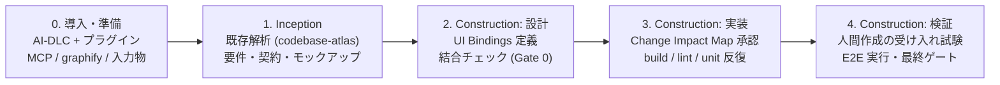

# AI-DLC Angular Edition (`fork/custom-for-angular`) 導入・使い方ガイド

このブランチは [`awslabs/aidlc-workflows`](https://github.com/awslabs/aidlc-workflows) の fork に対して、Angular フロントエンド開発向けのプラグイン **`angular`** と、既存コードの根拠付き解析プラグイン **`codebase-atlas`** を同梱した構成です。

`core/` と `harness/` には手を入れずプラグインとして追加しているため、upstream の更新を取り込みながら Angular プロジェクトでそのまま使えます。

## 全体像



| プラグイン | 役割 | 主な提供機能 |
| --- | --- | --- |
| `plugins/angular` | Angular 実装規約・UI 結合検証・受け入れ試験ゲート | `aidlc angular-mcp` / `aidlc angular-bindings-check` / `aidlc angular-cases`、3 種のセンサー、Angular 実装規約・ガイド |
| `plugins/codebase-atlas` | 既存コード解析の根拠 (`path:line`) と網羅性の検算 | `aidlc atlas-graph build` / `check`、2 種のセンサー、根拠付き解析ガイド |

## 人間が用意するもの（一覧）

| 区分 | 用意するもの | 必須 / 任意 | 配置場所 | 詳細 |
| --- | --- | --- | --- | --- |
| 環境ツール | 対応ハーネス（Claude Code / Codex / Kiro / Cursor / opencode / Copilot）・Git・Bun | 必須 | ローカルマシン | [導入手順](docs/angular/01-setup.ja.md#1-前提ツール) |
| 環境ツール | Angular プロジェクト側の Node.js・`@angular/cli`（MCP を使う場合は `20.2` 以上） | 必須（MCP は任意） | 対象 Angular リポジトリ | [導入手順](docs/angular/01-setup.ja.md#5-angular-cli-mcp-サーバーの設定任意推奨) |
| 環境ツール | Python 3.11+ / `uv` + 検証済みコミットの `graphify` | 任意（網羅検算用） | ローカルマシン | [導入手順](docs/angular/01-setup.ja.md#6-graphify-の導入任意網羅検算用) |
| 入力物 | 要件ドキュメント（機能要件 `FR*`・受け入れ基準 `AC*`） | 必須 | 対象リポジトリ（例: `docs/specs/`）またはチャットで提示 | [入力物と配置場所](docs/angular/02-inputs.ja.md#1-要件ドキュメント必須) |
| 入力物 | OpenAPI 仕様（`operationId` 付き `.yaml` / `.json`） | API ありなら推奨 | 対象リポジトリ（例: `docs/api/openapi.yaml`） | [入力物と配置場所](docs/angular/02-inputs.ja.md#2-openapi-仕様api-がある場合は推奨) |
| 入力物 | デザインモックアップ HTML/CSS（`data-ui-id` 付き） | UI ありなら推奨 | 対象リポジトリ（例: `docs/design/*.html`） | [入力物と配置場所](docs/angular/02-inputs.ja.md#3-デザインモックアップ-htmlcssui-がある場合は推奨) |
| 入力物 | 人間が書いた受け入れ試験仕様（`.xlsx` / `.csv` / `.md`） | 推奨（最終ゲート） | 対象リポジトリ（例: `docs/tests/acceptance-cases.xlsx`） | [入力物と配置場所](docs/angular/02-inputs.ja.md#4-人間が書いた受け入れ試験仕様最終ゲート推奨) |

## 最短スタート（Claude Code の例）

1. **AI-DLC 本体を導入し、この fork からプラグインをビルドする**

   ```bash
   # AI-DLC 本体の導入（macOS / Linux / WSL）
   curl -fsSL https://github.com/awslabs/aidlc-workflows/releases/latest/download/install.sh | sh

   # この fork の fork/custom-for-angular を取得してプラグインをビルド
   git clone -b fork/custom-for-angular https://github.com/sun-flat-yamada/aidlc-workflows.git
   cd aidlc-workflows
   bun install --frozen-lockfile
   bun scripts/package.ts
   ```

2. **対象の Angular リポジトリで AI-DLC を初期化する**

   ```bash
   cd /path/to/your-angular-app
   aidlc config
   ```

3. **Claude Code でプラグインを追加して新規セッションを開く**

   ```text
   /plugin marketplace add /path/to/aidlc-workflows/dist/plugins
   /plugin install aidlc-angular@aidlc-plugins
   /plugin install aidlc-codebase-atlas@aidlc-plugins
   ```

   セッションを開き直すと SessionStart フックが自動で合成（compose）します。Kiro / Codex など他ハーネスの手順は [導入手順](docs/angular/01-setup.ja.md#4-ハーネス別のプラグイン導入手順) を参照してください。

4. **（任意・推奨）Angular CLI MCP サーバーと `graphify` を有効化する**

   ```bash
   # 対象 Angular リポジトリで実行（ローカル・読み取り専用・オフライン設定）
   aidlc angular-mcp

   # 既存コードの独立ファイル網羅検算を使う場合のみ
   uv tool install git+https://github.com/sun-flat-yamada/graphify@14f35e381cab8d0ae10824a336114a907c288146
   ```

5. **導入結果を検証する**

   ```bash
   aidlc doctor
   aidlc engine plugin list
   ```

6. **開発フローを開始する**

   ハーネスのチャットで `/aidlc <実装したい機能や入力ファイルの場所>`（Codex は `$aidlc ...`）を実行します。各ゲートで確認する観点は [開発フローと確認事項](docs/angular/03-workflow.ja.md) を参照してください。

## 詳細ドキュメント

| ドキュメント | 内容 |
| --- | --- |
| [01. 導入手順](docs/angular/01-setup.ja.md) | 前提ツール、AI-DLC 本体とプラグインのビルド・導入（ハーネス別）、MCP・`graphify` 設定、`aidlc doctor` での確認手順 |
| [02. 人間が用意する入力物と配置場所](docs/angular/02-inputs.ja.md) | 対象リポジトリのディレクトリ構成、要件・OpenAPI・モックアップ・受け入れ試験仕様（Excel/CSV/Markdown）の書式と配置ルール、入力間の優先順位 |
| [03. 開発フローと各ゲートでの確認事項](docs/angular/03-workflow.ja.md) | Inception〜Construction の各ステージで AI が行うこと、プラグインが効かせる検査、人間が承認ゲートで確認すべき具体項目 |
| [04. コマンド・センサー・トラブルシューティング](docs/angular/04-commands-and-checks.ja.md) | 全 4 コマンドのオプションと実行例、全 5 センサーの発火条件と検査内容、よくあるエラーの対処法 |

## 関連ドキュメント

- 設計・取り込みの背景: [`plugins/angular/ADOPTION.ja.md`](plugins/angular/ADOPTION.ja.md) / [`plugins/angular/PROPOSALS.ja.md`](plugins/angular/PROPOSALS.ja.md) / [`plugins/codebase-atlas/ADOPTION.ja.md`](plugins/codebase-atlas/ADOPTION.ja.md)
- プラグイン概要（英語）: [`plugins/angular/README.md`](plugins/angular/README.md) / [`plugins/codebase-atlas/README.md`](plugins/codebase-atlas/README.md)
- upstream AI-DLC のガイド: [`docs/guide/01-getting-started.md`](docs/guide/01-getting-started.md) / [`docs/harness-engineering/10-authoring-a-plugin.md`](docs/harness-engineering/10-authoring-a-plugin.md)
- fork 運用・upstream 同期: [`dev/fork-sync.md`](dev/fork-sync.md) / [`dev/change-dev.md`](dev/change-dev.md)
